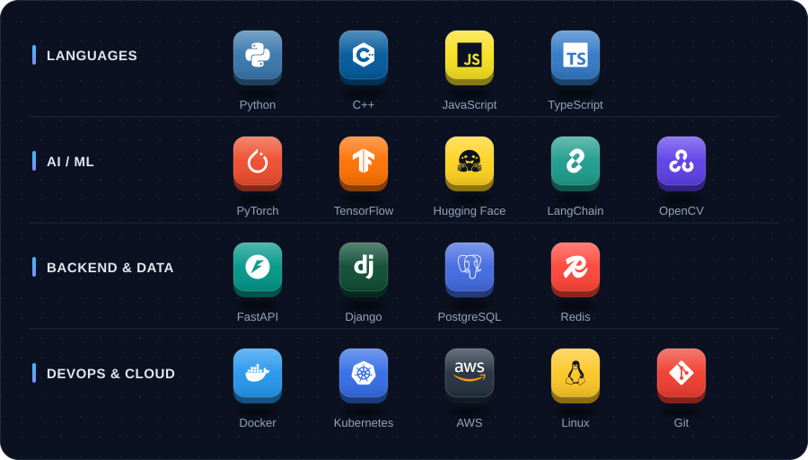
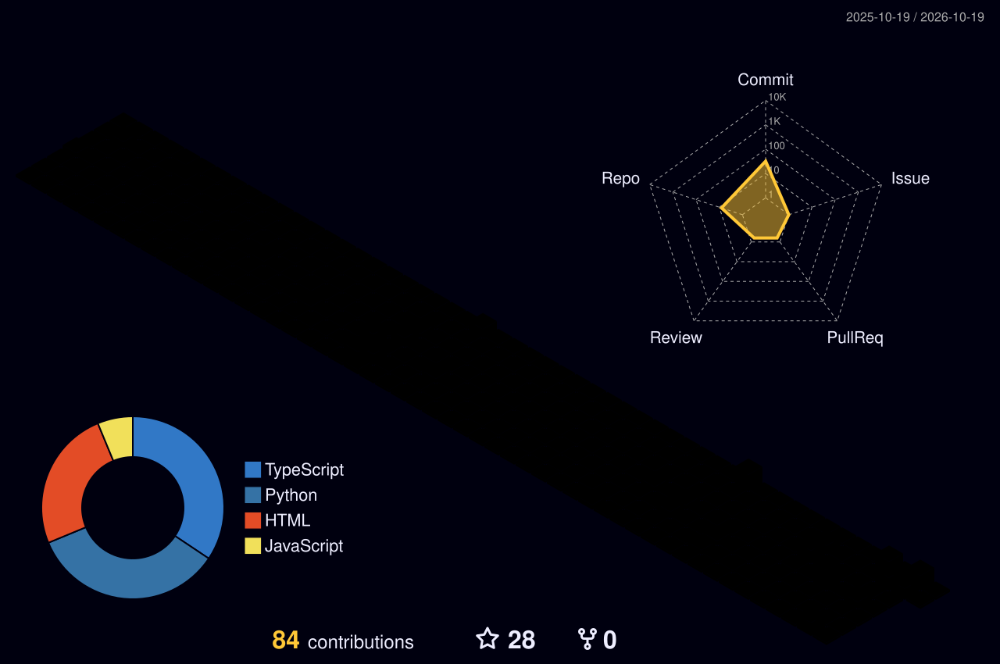

  

  
  
  

## About Me

  

I work at the intersection of software engineering and artificial intelligence, taking models from experiment to deployed service: reliably, efficiently and with maintainable code.

- **LLM Engineering:** retrieval-augmented generation (RAG), fine-tuning (LoRA / QLoRA), conversational agents and prompt design
- **Computer Vision:** object detection, OCR, open-vocabulary grounding (Grounding DINO) and recognition pipelines
- **Backend & APIs:** RESTful services with FastAPI and Django, relational and vector databases
- **MLOps:** containerized deployment, CI/CD for ML, model monitoring and reproducible training

## Tech Stack

  

## Featured Projects

  
  
  
  
  
  

Example workflow: <a href="examples/Training_Script_example.ipynb">Grounding DINO training notebook</a>

## GitHub Activity

  

  
  

## Get in Touch

I'm open to discussing AI system design, open-source collaboration and engineering opportunities.

  
  <!-- Add your contact links here, e.g.:
  
  
  -->

  

<!-- Images in assets/ are generated by scripts/build_assets.py; profile-3d-contrib/ is updated daily by .github/workflows/profile-3d-contrib.yml -->
